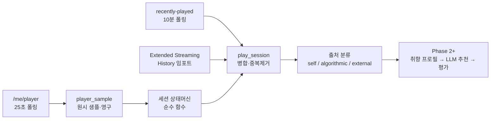

# spotify-better-taste

Spotify 청취 로그를 자체 수집·축적하고, **자발적 재생과 알고리즘 유도 재생을
분리해** 취향 모델을 만든 뒤, LLM으로 주간 추천 플레이리스트를 생성하고 그
성과를 Discover Weekly와 나란히 측정하는 개인용 시스템.

## 왜 만들었나

Spotify 추천이 아쉬운 이유를 세 가지 가설로 본다:

1. **내 자발적 선택과 알고리즘이 틀어준 것을 구분하지 않는다** — 오토플레이로
   흘러나온 곡을 끝까지 들었다고 그게 취향인 건 아니다
2. **컨텍스트(시간대·목적)를 반영하지 않는다** — 새벽에 듣는 것과 운동하며
   듣는 것은 다른 취향이다
3. **탐색 폭이 좁다** — 안전한 유명곡 주변만 맴돈다

이 셋을 직접 통제하려면 청취 로그를 내가 소유해야 한다. 그래서 만들었다.

## 전제: 2026년의 Spotify Web API

이 프로젝트의 설계는 API 축소의 산물이다. 오래된 튜토리얼은 대부분 동작하지
않는다:

| 사라진 것 | 이 프로젝트의 대응 |
|---|---|
| `/audio-features` (BPM·energy·valence) | LLM 합성 태그(Phase 3) — `artist.genres` 도 2026-08 에 사라졌다 |
| `/recommendations` (추천 엔진) | 이 프로젝트가 LLM으로 직접 만든다 (Phase 4) |
| 복수 조회 전부 (`GET /tracks?ids=…`) | 1엔티티=1콜 → 재생횟수순 **예산제 야간 백필** |
| `popularity` 필드 | `album.release_date`가 유일한 era 신호 |
| Spotify 생성 플레이리스트 조회 (404) | URI 접두사 `37i9dQZ`로 판별 |

전체 목록은 [CLAUDE.md](CLAUDE.md) 참조.

## 구조



**수집과 해석은 분리된다.** 폴러는 원시 데이터만 적재하고, 세션 판정
(`sessions/machine.py`)과 출처 판정(`classify/rules.py`)은 저장된 데이터에서
**언제든 재계산 가능**하다. 판정 규칙이 바뀌면 `RULES_VERSION`을 올리고
`classify run --stale`로 과거 전체를 새 규칙으로 다시 계산한다 — dry-run이
기본값이라 전이 행렬을 먼저 보고 쓴다.

### 신호의 등급

같은 "재생 1건"이라도 출처마다 신뢰도가 다르고, 절대 섞지 않는다:

| 출처 | ms_played | 타이밍 | 비고 |
|---|---|---|---|
| 주 폴러 | **실측** (progress 궤적) | 초 단위 | 스킵 지점·탐색까지 잡힘 |
| history export | **실측** (Spotify 기록) | 초 단위 | `reason_start`/`skipped` 판정 포함 |
| recently-played | 없음 (NULL) | 30초 반올림 | 갭 필러. 추정치는 별도 컬럼 |

완성도 지표도 둘로 나뉜다: `completion_ratio`(재생 헤드가 어디까지 갔나)와
`listened_ratio`(실제로 얼마나 들었나). 80% 지점으로 스크럽하고 끝까지 두면
전자는 1.0, 후자는 0.2다 — positive 라벨은 둘 다 요구한다.

**실측은 재생 기기가 Spotify 와 연결돼 있을 때만 얻어진다.** 기기가 오프라인
으로 재생하면 `/me/player` 는 204 만 돌려주고, 그 구간은 recently-played 로
뒤늦게(수십 분~하루) 들어와 추정치만 남는다. 수집기 고장과 구별하는 지표는
**RP 반영 지연**(`created_at - started_at`)이다 — 수집기가 죽었으면 지연이
정상이고, 기기가 오프라인이면 폭증한다. 실제 사례는 [todo-list.md](todo-list.md)
의 "2026-08-23 사고".

## 시작하기

**먼저 [manual.md](manual.md)의 Step 0** — Premium 구독(하드 블로커), 앱 등록,
Extended Streaming History 신청(수일~30일), Telegram 봇. 리드타임이 긴 것부터.

```bash
cp .env.example .env                     # 값 채우기
uv sync
uv run spotify-taste db migrate
uv run spotify-taste auth login          # PKCE — Client Secret 불필요
uv run spotify-taste ops preflight       # 전제 조건 일괄 확인
zsh scripts/launchd-install.sh           # 상시 수집 시작 (launchd 잡 9개)
```

과거 데이터가 있다면:

```bash
uv run spotify-taste import history --dir data/import/extended-history   # dry-run
uv run spotify-taste import history --write
```

## 명령

| 명령 | 하는 일 |
|---|---|
| `auth login / status / logout` | PKCE 인증 · 토큰 상태(네트워크 안 씀) |
| `collect` / `collect --once` | 상시 수집 / 1틱 진단 |
| `import history` | Extended Streaming History 임포트 (멱등) |
| `sessions rebuild` | 저장된 샘플에서 세션 재계산 |
| `classify run / report` | 출처 재분류 / 분포·건강 지표 |
| `backfill run / status` | 예산제 카탈로그 백필 / 큐 깊이 |
| `snapshot all / library / top / me` | 라이브러리·플레이리스트·수록곡·top 스냅샷 |
| `features params / build / behavior / top` | 파라미터 · 0·1층 계산 · 3층 행동 프로파일 · 친화도 상위 |
| `db migrate / verify / stats / backup / prune / integrity-check` | DB 운영 |
| `ops preflight / heartbeat-check / report / status / test-alert / telegram-chat-id` | 진단·감시 |

파괴적·대량 동작은 전부 **dry-run이 기본값**이다 (`--write`로 저장).

## 무인 운영

launchd 잡 9개가 전부다. 사람이 개입하는 경우는 Telegram이 알려 준다.

| 일정 | 잡 |
|---|---|
| 상시 (KeepAlive) | `collect` — 25초 폴링 + 10분 recently-played |
| 5분마다 | `heartbeat-check` — 파일 mtime **과 실제 적재 시각**을 함께 검사 |
| 02:30 / 03:30 / 04:10 / 04:40 / 04:50 / 05:00 | 로그 로테이션 / 백필 / 스냅샷 / 분류 / **취향 특성** / 백업 |
| 09:00 | 일일 리포트 → Telegram |

장애 알림은 종류별 쿨다운으로 분리돼 있고, 알림 실패가 수집을 멈추지 않는다.
토큰이 폐기되면 알림 + 재인증 센티넬을 남기고 종료하며, 래퍼가 센티넬을 보고
재시작 폭풍을 막는다.

## 설계 원칙

- **수집기는 해석하지 않는다.** 원시 데이터 적재와 판정을 분리해야 규칙을
  바꿔도 과거를 다시 계산할 수 있다.
- **행을 지우지 않는다.** 중복·팬텀은 `superseded_by`/`suspect_phantom`으로
  표시하고, 모든 분석은 `v_clean_session` 뷰를 읽는다.
- **실측을 날조하지 않는다.** 추정치는 실측과 다른 컬럼에 산다. 애매하면
  NULL이 정답이다.
- **원본을 보관한다.** API 응답 원문을 2계층으로 아카이브하고, **처음 보는
  응답 모양이 오면 Telegram이 울린다** — 필드 삭제가 계속되는 API에 대한
  조기 경보다.
- **null context는 unknown이다.** 오토플레이도 context가 null로 온다. 그걸
  self로 추측하면 Spotify의 추천으로 학습해 놓고 "내 취향"이라 부르게 된다.
- **알림이 잦으면 아무도 안 본다.** 종류별 쿨다운, 상태 변화 오탐 접기,
  경고에는 반드시 "무엇을 하라"를 붙인다.

## 로드맵

- [x] **Phase 1 — 수집 기반**: OAuth PKCE, 이중 폴러, 세션 재구성, 출처 분류,
  백필, launchd, dead-man switch
- [x] **Extended Streaming History 임포터** (Phase 2에서 앞당김)
- [ ] **Phase 2 — 취향 특성**: 0층(재생 가중치)·1층(엔티티 친화도)·3층(행동
  프로파일) 완료. 2층(장르 벡터)만 남았고 `artist.genres` 소멸로 외부
  소스(MusicBrainz + Last.fm)에서 가져와야 한다
- [ ] **Phase 3 — LLM 태깅**: audio-features의 대체재 (mood/era/energy)
- [ ] **Phase 4 — 주간 추천 생성**: core/adjacent/explore 슬롯, 비공개
  플레이리스트 발행
- [ ] **Phase 5 — 평가**: hit rate를 Discover Weekly와 정면 비교
- [ ] **Phase 6 — 피드백 루프**: 프롬프트 A/B, 주간 다이제스트

## 제약

- **Development Mode**: Premium 필수, Client ID는 개발자당 1개, 인증 사용자
  최대 5명. 이 코드를 쓰려면 **본인 Client ID를 발급**해야 한다.
- 카탈로그(단건 조회) 일일 쿼터는 실측 기준 600~1,000콜 수준이다. 대량
  백필은 주 단위로 잡을 것 — 시스템이 알아서 예산 안에서 나눠 돈다.

## 개발

```bash
uv run ruff check . && uv run ruff format --check . && uv run mypy && uv run pytest
```

Python 3.14 · stdlib sqlite3 (ORM 없음) · httpx · Typer · structlog.
테스트 625개. 코딩 규약은 [CLAUDE.md](CLAUDE.md)와 서브패키지별 CLAUDE.md 참조.
